<div align="center">

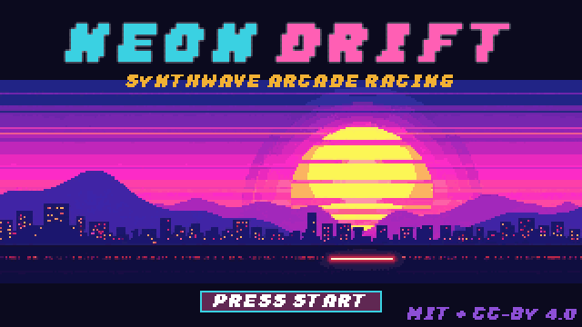

### Synthwave arcade racing with a Game Boy Advance soul

Pseudo-3D roads · five tunable 80s cars · nitro · air-thruster jumps · online rooms for up to 8

**Free and open source:** MIT code, CC BY 4.0 art and music.

[](https://github.com/henriquerochars/neon-drift/actions/workflows/test.yml)


[](LICENSE)
[](LICENSING.md)
[](CONTRIBUTING.md)

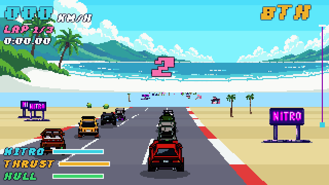

<sub>Real gameplay at native 320×180, scaled 2×. Coast Run, Vortex, seed 7: from 8th on the grid to 1st in five seconds.</sub>

</div>

---

## The pitch

Neon Drift is a love letter to the behind-the-car racers of the 16- and 32-bit era. The road is
drawn the old way, segment by segment, with curves, hills, roadside palms and billboards rushing
at you. Pick one of five cars, bolt on parts in the garage, paint it, then race seven rivals
across three tracks. Hit **nitro** to paint the asphalt blue, or fire the **air thrusters** to hop
over traffic. Land on top of someone and you crush them, but your car takes a hard landing too.

## Features

<table>
<tr>
<td width="50%" valign="top">
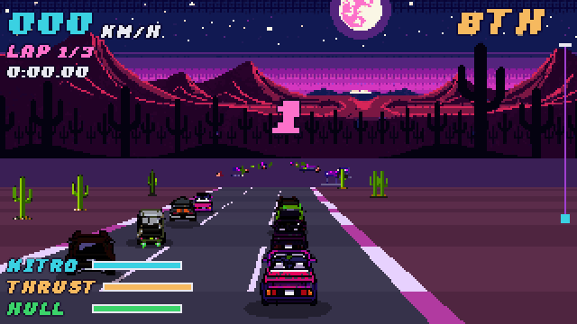
<p><b>Air thrusters and crushes.</b> Jump over a slower car, or land on it. The victim loses most of its speed and some hull; you take a hard landing.</p>
</td>
<td width="50%" valign="top">
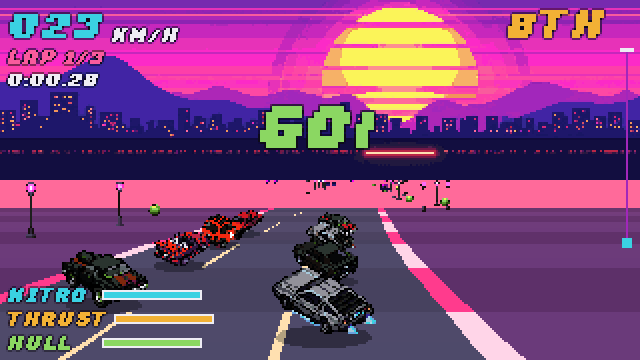
<p><b>Nitro and drafting.</b> Burn the whole gauge for a burst above top speed. It refills on the road and faster in a rival's slipstream.</p>
</td>
</tr>
<tr>
<td width="50%" valign="top">
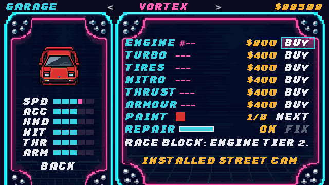
<p><b>Garage tuning.</b> Six slots with three tiers each: engine, turbo, tires, nitro tank, thrusters and armour. Eight paint jobs and repairs. Everything persists.</p>
</td>
<td width="50%" valign="top">
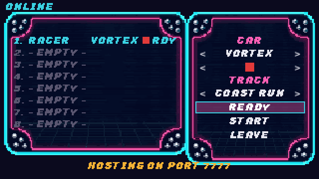
<p><b>Online rooms.</b> One player hosts, up to eight race. Each player drives their own car with zero input lag; the host referees the countdown, crushes and the finish order.</p>
</td>
</tr>
</table>

## The garage line-up

<p align="center">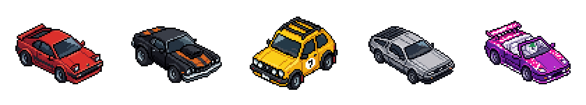</p>

| Car | Style | Speed | Accel | Handling | Nitro | Thrusters | Armour |
|---|---|:-:|:-:|:-:|:-:|:-:|:-:|
| **Vortex** | balanced wedge coupe | ▰▰▰▱▱ | ▰▰▰▱▱ | ▰▰▰▱▱ | ▰▰▰▱▱ | ▰▰▰▱▱ | ▰▰▰▱▱ |
| **Bruiser** | heavy muscle car | ▰▰▰▰▰ | ▰▰▱▱▱ | ▰▱▱▱▱ | ▰▰▱▱▱ | ▰▰▱▱▱ | ▰▰▰▰▰ |
| **Hornet** | nimble rally hatch | ▰▰▱▱▱ | ▰▰▰▰▱ | ▰▰▰▰▰ | ▰▰▱▱▱ | ▰▰▰▱▱ | ▰▰▱▱▱ |
| **Phantom** | nitro specialist | ▰▰▰▰▱ | ▰▰▰▱▱ | ▰▰▱▱▱ | ▰▰▰▰▰ | ▰▰▱▱▱ | ▰▰▱▱▱ |
| **Mirage** | jump specialist | ▰▰▰▱▱ | ▰▰▰▱▱ | ▰▰▰▱▱ | ▰▰▱▱▱ | ▰▰▰▰▰ | ▰▱▱▱▱ |

## Three tracks, three laps

<p align="center">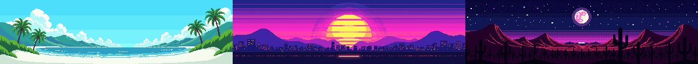</p>

**Coast Run** has palms, sea breeze and long sweeping curves. **Sunset City** is downtown at
golden hour, with tight corners between the towers. **Desert Night** puts mesas under the moon,
with big hills and big air.

## Screens

<table>
<tr>
<td>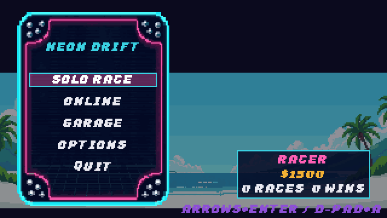</td>
<td>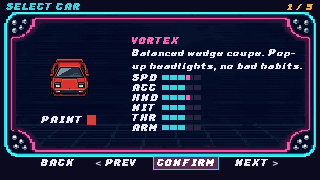</td>
<td>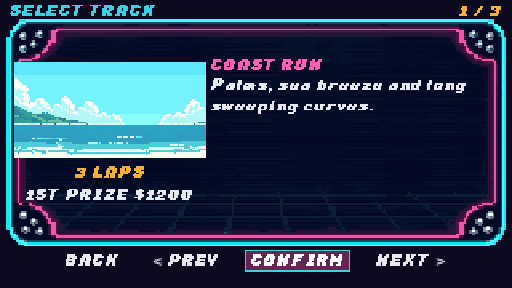</td>
</tr>
<tr>
<td>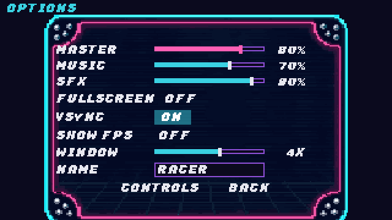</td>
<td>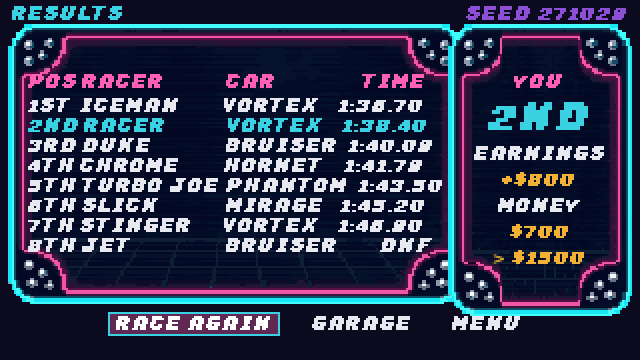</td>
<td></td>
</tr>
</table>

## Controls

| Action | Keyboard | Gamepad |
|---|---|---|
| Steer | <kbd>A</kbd> <kbd>D</kbd> or <kbd>←</kbd> <kbd>→</kbd> | Left stick / D-pad |
| Accelerate | <kbd>W</kbd> or <kbd>↑</kbd> | <kbd>A</kbd> / Right trigger |
| Brake | <kbd>S</kbd> or <kbd>↓</kbd> | <kbd>X</kbd> / Left trigger |
| Nitro | <kbd>Shift</kbd> or <kbd>K</kbd> | <kbd>Y</kbd> |
| Thruster jump | <kbd>Space</kbd> or <kbd>J</kbd> | <kbd>B</kbd> |
| Pause | <kbd>Esc</kbd> or <kbd>P</kbd> | <kbd>Start</kbd> |

Menus use the arrow keys or D-pad and <kbd>Enter</kbd> / <kbd>A</kbd>. The full binding list is
under **Options → Controls**.

## Play it

You need Godot **4.7.2** (standard build, no .NET). On Linux or macOS the repository can fetch the
pinned engine for you:

```sh
git clone https://github.com/henriquerochars/neon-drift.git
cd neon-drift
tools/setup_godot.sh          # downloads Godot 4.7.2 into .tools/ (verified checksums)
tools/agent.sh bootstrap      # imports the project and prepares the lint venv
tools/godot.sh                # run the game
```

You can also open `project.godot` in your own Godot 4.7.2 editor and press **F5**.

**Online:** one player chooses *Online → Host* (default port `7777`). The others choose
*Online → Join* and type the host's address and port. Join codes and NAT traversal are not in
yet, so players outside a LAN need the host to open or forward the port.

## Under the hood

- **Renderer:** classic segment projection in a `Node2D._draw()`, with billboard sprites, hill
  clipping, parallax backgrounds and fog, on the Compatibility renderer (see [ADR 0001](docs/adr/0001-pseudo-3d-renderer.md)).
- **Simulation:** `CarSim` is a pure, deterministic function over `CarState`. AI drivers,
  contacts, crushes and seeded race runs are all headless-testable.
- **Netcode:** Godot high-level multiplayer over ENet. Peers own their cars; the host owns the
  race phase, verdicts and results (see [ADR 0002](docs/adr/0002-network-model.md) and [NET_API](docs/NET_API.md)).
- **Data-driven:** cars, parts and tracks are typed `Resource` files under `data/`; physics
  tunables live in [`data/balance/physics.csv`](data/balance/physics.csv).
- **Art:** every sprite, background, UI panel, the pixel font and the VFX were generated with
  [PixelLab](https://pixellab.ai) and imported with recorded provenance (`art/source/pixellab/`).
- **Audio:** the synthwave soundtrack and all sound effects come from a deterministic
  standard-library synthesizer, [`tools/audio/gen_audio.py`](tools/audio/gen_audio.py).

```
src/core      contracts, autoload buses (RaceBus, GameSettings, PlayerProfile)
src/data      CarDef, PartDef, TrackDef, catalog, balance loader
src/gameplay  sim/ road/ race/ ai/ input/
src/net       NetSession lobby, RaceSync
src/ui        title, menu, select, garage, options, lobby, hud, pause, results
src/audio     AudioDirector
```

## Built by an agent team

Neon Drift was planned and built by a small orchestra of AI coding agents working in parallel git
worktrees (race core, networking, UI, audio), then reviewed, play-tested and integrated. They run
inside a shared harness: a changed-scope validation gate with receipts, a guard against
destructive commands, a layer checker and headless tests. Start with [`AGENTS.md`](AGENTS.md) and
[`docs/ai/`](docs/ai/README.md).

```sh
tools/agent.sh check          # lint, layer graph, balance, art, harness and headless tests
tools/test.sh                 # gdUnit4 suite only
tools/playtest/readme_media.sh  # re-record every GIF and screenshot in this README
```

## Roadmap

- Join codes and NAT traversal through a relay
- Verified Windows, Android and Web exports, and touch controls
- Driver portraits, more tracks and a championship mode
- A balance pass on cornering speed, plus human playtesting of feel

Ideas and bug reports are welcome in [Issues](https://github.com/henriquerochars/neon-drift/issues).

## Contributing

Neon Drift is open source and contributions are welcome: code, tracks, cars, parts, art, sounds,
balance feedback and bug reports. Read [CONTRIBUTING.md](CONTRIBUTING.md) to set up, run the
gate and open a pull request. New cars, parts and tracks are data files, so many contributions
need no code at all. Please follow the [Code of Conduct](CODE_OF_CONDUCT.md) and report security
problems privately as described in [SECURITY.md](SECURITY.md).

## License

| What | License |
|---|---|
| Code, scenes, data, tests and tools | [MIT](LICENSE) |
| Art (`art/`, `docs/media/`) | [CC BY 4.0](art/LICENSE) |
| Music and sound effects (`audio/`) | [CC BY 4.0](audio/LICENSE) |

You may use, change and share all of it, including commercially, as long as you keep the
copyright notice (MIT) or credit "Neon Drift art/audio, Henrique Rocha Serrano" (CC BY 4.0).
Details in [LICENSING.md](LICENSING.md), [credits](CREDITS.md) and
[third-party notices](THIRD_PARTY_NOTICES.md). Inspired by the arcade and handheld racers of the
80s and 90s; no assets or names from other games are used.
